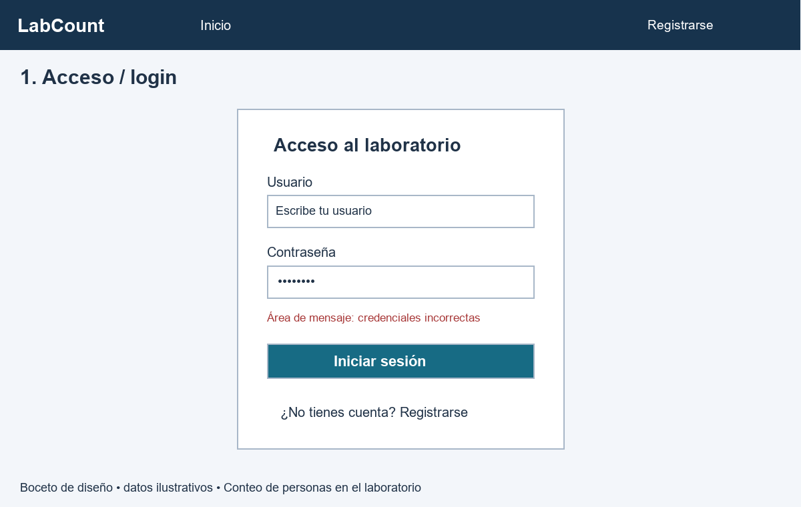
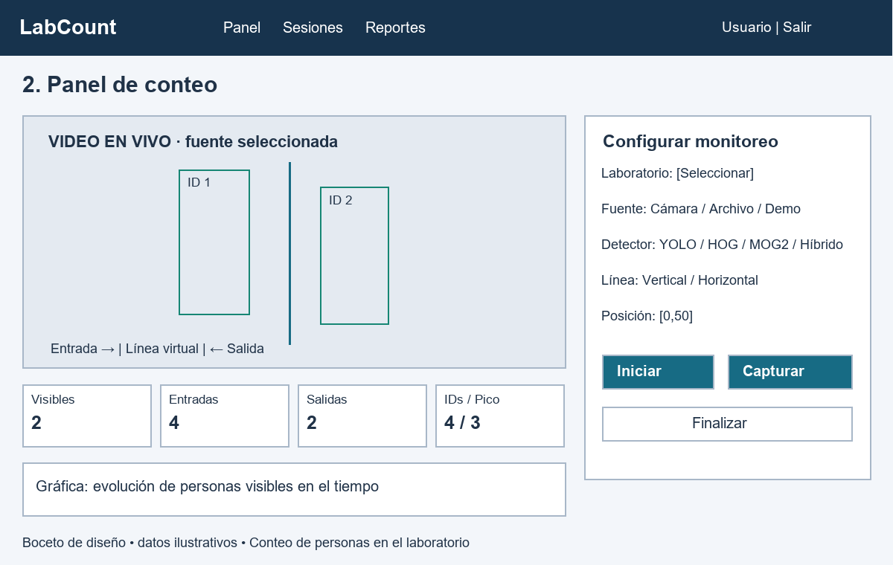
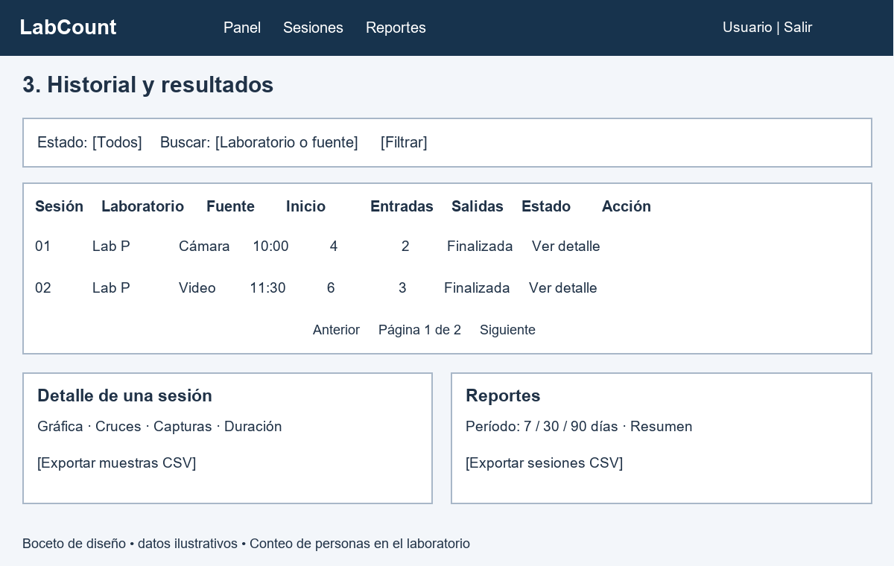
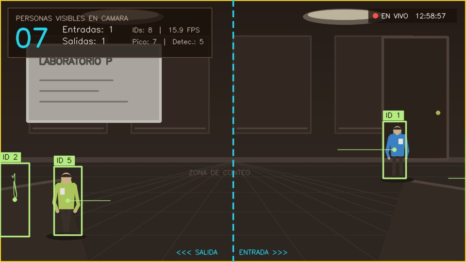

# Informe de práctica — Conteo de personas en el laboratorio

**Universidad Estatal de Milagro (UNEMI)**

**Asignatura:** Construcción de Software

**Guía:** G003-S12

**Aplicación:** LabCount

**Fecha de revisión técnica:** 9 de noviembre de 2026
**Estado:** borrador editable para la plantilla oficial. Hay capturas con cámara real y tablero Jira; faltan mediciones manuales, video conforme a la duración, enlace Drive y PDF final.

## 1. Introducción y objetivo

El proyecto aborda el conteo de personas visibles mediante una aplicación web. Integra Python y Django para la aplicación, OpenCV para capturar y procesar video, y PostgreSQL para conservar sesiones y resultados. Permite iniciar monitoreo, observar video con anotaciones y consultar datos posteriormente.

El objetivo de la práctica es desarrollar una aplicación web que capture imágenes o video en tiempo real, los procese con OpenCV y presente resultados útiles en una interfaz interactiva. Se seleccionó exclusivamente la temática «Conteo de personas en el laboratorio».

## 2. Alcance

LabCount dispone de registro y acceso, selección de cámara/archivo/demo, detección, seguimiento con identificadores temporales, cruces de línea, capturas, historial y CSV. PostgreSQL conserva los registros y `media/` conserva las imágenes.

El número mostrado estima personas visibles en cámara; no representa necesariamente la ocupación de toda la sala. Los identificadores no son identidades personales. La demo es sintética y debe presentarse como simulación.

## 3. Organización del equipo

Tema: **Conteo de personas en el laboratorio**. Guía G003-S12, grupo de cinco integrantes.
Nombres y roles proporcionados por el equipo; responsabilidades adaptadas al tema. La asignación no constituye evidencia de trabajo ya realizado.

| Integrante | Rol | Responsabilidades y entregables |
|---|---|---|
| Murillo García Darlyn Joshua | Líder | Coordinar al equipo; administrar Jira y el archivo compartido de bocetos; priorizar actividades; revisar la estimación del esfuerzo; coordinar revisión y entrega del repositorio, PDF y video. |
| Crespo Ayala Billy Dilson | Desarrollador 1 | Diseñar el acceso/login; revisar registro, autenticación e interfaz web; aportar riesgos de codificación; participar en las reglas y gestionar sus tareas en Jira. |
| Torres Morales Deyvi Matheus | Desarrollador 2 | Diseñar el panel de conteo; revisar integración Django–OpenCV, cámara, detección, seguimiento y conteo; aportar riesgos de integración; gestionar sus tareas en Jira. |
| Román Gamarra Ruth Noemi | Documentadora | Redactar roles y reglas; exportar bocetos; documentar riesgos de configuración; consolidar matriz, evidencias e informe en la plantilla del docente; gestionar sus tareas en Jira. |
| Patiño Suárez Jorge Alfredo | QA | Diseñar el boceto del historial/resultados; preparar y ejecutar casos de prueba; verificar resultados y riesgos de calidad; apoyar la configuración de Jira y comprobar estados reales de tareas. |

### Reglas de trabajo colaborativo

1. Cada tarea tendrá un responsable, criterio de aceptación y evidencia en Jira; su estado reflejará el trabajo real.
2. Antes de editar, sincronizar el repositorio; trabajar en una rama propia y solicitar revisión de otro integrante antes de integrar cambios.
3. Comunicar bloqueos y cambios de alcance al líder el mismo día; registrar las decisiones compartidas en Jira o documentación.
4. Comprobar los cambios con las pruebas aplicables y explicar su resultado en la revisión; no declarar pruebas aprobadas sin ejecutarlas.
5. Mantener documentación, bocetos y manual acordes con la aplicación; Ruth consolida los aportes y cada autor revisa su contenido.
6. No subir contraseñas, `.env`, entornos virtuales ni datos personales; compartir únicamente ejemplos y evidencias autorizadas.
7. Revisar conjuntamente los entregables antes del plazo de la plataforma: PDF, enlaces accesibles, video de hasta tres minutos y repositorio reproducible.
8. Todos participarán en la práctica y exposición; reconocer los materiales y código de base utilizados y explicar los aportes propios.

La protección de ramas y los permisos de Jira deben configurarse y verificarse en los servicios reales; este documento no los activa.

## 4. Desarrollo según la guía

### Sesión 1: configuración y captura

Se revisó el proyecto Django descargado del repositorio base. Se preparó PostgreSQL 16.15 local, la base `conteo_lab` y sus migraciones. Existe captura OpenCV y transmisión MJPEG. El transporte se comprobó con fuente sintética; las capturas de Ruth muestran apertura de cámara real, sin medición sistemática de precisión.

### Sesión 2: procesamiento y detección

La implementación dispone de YOLO mediante OpenCV DNN, HOG, movimiento MOG2 e híbrido. Las detecciones alimentan el seguimiento y los cruces. Se dibujan cajas, identificadores, línea y estadísticas sobre la imagen. MOG2 detecta movimiento y puede confundir objetos con personas.

Se corrigió la carga ONNX desde rutas Windows con tildes: Python abre el archivo y entrega sus bytes a OpenCV. Se añadieron pruebas para rutas Unicode y modelos corruptos.

### Sesión 3: interfaz y pruebas

Se revisaron rutas, plantillas, permisos y documentación. Se aclararon los rótulos para distinguir personas visibles e identificadores registrados. Se ejecutaron 62 pruebas sin fallos ni omisiones y un recorrido HTTP de demo, captura, finalización, historial y reportes. Las capturas iniciales mostraban tarjetas laterales en cero frente a conteos no nulos en video. Se corrigió una excepción JavaScript de la gráfica y se repitió la demo en el navegador: las tarjetas actualizaron ocupación, entradas, salidas y FPS. Falta medir el conteo con personas reales.

## 5. Bocetos de interfaz

Son propuestas de diseño, no capturas de ejecución. La rúbrica menciona pantallas de biblioteca mientras la guía permite este tema; confirmar con el docente la adaptación a acceso, conteo e historial.

### Acceso



Usuario, contraseña, inicio de sesión, acceso al registro y mensajes de error.

### Panel de conteo



Fuente, detector, configuración de línea, video anotado, indicadores y controles.

### Historial y resultados



Filtros, sesiones, detalle y exportación. Los SVG editables están en `docs/bocetos/`.

## 6. Arquitectura y datos

El navegador consume páginas Django, estadísticas JSON y video MJPEG. `StreamManager` administra fuente y persistencia. `PeopleCounter` combina detector, seguimiento, cruces y anotaciones.

| Modelo | Finalidad |
|---|---|
| Laboratory | Datos del laboratorio |
| MonitoringSession | Fuente, configuración y resumen de sesión |
| OccupancySample | Muestras temporales del conteo |
| CrossingEvent | Cruces y dirección |
| Snapshot | Metadatos y referencia a imagen |

El historial se filtra por propietario, con acceso adicional para staff. El video activo se comparte entre autenticados del mismo proceso. Se admite una sesión activa por proceso. [Arquitectura detallada](ARCHITECTURE.md).

## 7. Matriz de riesgos

P e I: 1=bajo, 2=medio, 3=alto. Prioridad=P×I. Responsables de seguimiento según los roles del equipo. Se describen riesgos potenciales, no incidentes ya ocurridos.

| ID | Riesgo | Causa | Impacto en el proyecto | P | I | Prioridad | Acción preventiva | Contingencia | Responsable |
|---|---|---|---|---|---|---|---|---|---|
| R1 | Entrega incompleta | Subestimar pruebas, evidencias y grabación | Pérdida de puntos y atraso | 2 | 3 | 6 | Dividir tareas en Jira, revisar avances y reservar tiempo para validar enlaces | Priorizar requisitos obligatorios y avisar bloqueos | Darlyn Joshua |
| R2 | Error en acceso o interfaz | Validación incompleta o cambios sin revisión | El usuario no puede iniciar el monitoreo | 2 | 2 | 4 | Probar registro/login, campos inválidos y navegación; revisión entre compañeros | Corregir el cambio y repetir el caso fallido | Billy Dilson |
| R3 | Cámara o video no disponible | Cámara ocupada, índice equivocado o códec no compatible | No se puede demostrar captura real | 2 | 3 | 6 | Probar la misma cámara y video antes de grabar; cerrar aplicaciones que la usan | Corregir permisos/índice; usar archivo de respaldo, identificado como grabado | Deyvi Matheus |
| R4 | Base de datos desconectada | Servicio detenido o variables incorrectas | No se guardan sesiones, muestras ni resultados | 2 | 3 | 6 | Verificar PostgreSQL, migraciones y `/health/`; documentar arranque sin publicar secretos | Restablecer servicio/configuración y comprobar persistencia | Ruth Noemi |
| R5 | Conteo incorrecto | Oclusiones, contraluz, movimiento de objetos o pérdida de seguimiento | Resultados distintos del conteo manual | 3 | 3 | 9 | Ensayar escenas reales con conteo manual; ajustar cámara, detector y línea; registrar errores | Documentar limitaciones y repetir pruebas en condiciones controladas | Jorge Alfredo y Deyvi Matheus |
| R6 | Video con retraso | Resolución elevada o CPU insuficiente | Resultados poco fluidos en tiempo real | 2 | 2 | 4 | Medir FPS en el equipo de exposición y ajustar resolución/frecuencia | Reducir carga y repetir la prueba; MOG2 detecta movimiento, no garantiza personas | Deyvi Matheus |
| R7 | Exposición de datos | Publicar `.env`, capturas identificables o enlaces con permisos excesivos | Divulgación de información privada | 2 | 3 | 6 | Revisar archivos antes del push; usar participantes autorizados y permisos de lectura | Retirar la evidencia afectada y cambiar credenciales expuestas | Ruth Noemi y Darlyn Joshua |
| R8 | Falta de evidencia evaluable | Jira solo descrito en Markdown, video sin permisos o PDF sin enlaces | No se puede comprobar la rúbrica | 2 | 3 | 6 | Revisar checklist y abrir enlaces desde una cuenta diferente antes de entregar | Completar tablero, capturas y enlaces funcionales | Darlyn Joshua y Jorge Alfredo |
| R9 | Pérdida de registros | Fallo del equipo o eliminación del directorio de PostgreSQL | Pérdida de sesiones y evidencias | 2 | 2 | 4 | Respaldar base y archivos multimedia antes de cambios de entorno | Restaurar respaldo y repetir validaciones | Darlyn Joshua |

Revisar primero riesgos con prioridad ≥6. La demostración sintética permite verificar el flujo, pero no sustituye la evidencia de detección de personas reales.

## 8. Organización en Jira

Se creó el [tablero Jira LAB](https://proyecto-practico-experimentental.atlassian.net/jira/software/projects/LAB/boards/34?filter=&groupBy=none) con columnas **Por hacer**, **En curso** y **Listo**. Tiene 12 tareas asignadas a los cinco integrantes, cada una con descripción y criterio de aceptación. Al revisarlo: 7 Por hacer, 5 En curso y 0 Listo. [Detalle de tareas](JIRA_BOARD.md). Faltan capturas del tablero para el PDF y verificar el acceso del docente.

## 9. Pruebas y resultados

| Verificación | Resultado |
|---|---|
| Revisión Django | Sin problemas identificados |
| Migraciones | Aplicadas; sin cambios de modelos pendientes |
| Dependencias | Sin conflictos detectados por pip |
| Suite con PostgreSQL | 62 pruebas, 19,815 s, OK; ninguna omitida |
| Salud del servicio | HTTP 200; PostgreSQL y OpenCV OK |
| Demo por HTTP | Login, inicio, JPEG/MJPEG, captura, parada, historial y CSV correctos |
| Persistencia demo | Sesión 1 finalizada; 3 muestras, 2 cruces y 1 captura con archivo existente |
| Cámara real | Abierta y visible en capturas de Ruth; conteo manual y precisión pendientes |
| Revisión visual del navegador | Portada, panel, demo, historial y reportes; demo del panel repetida tras corrección, casos reales pendientes |

[Salida automatizada](evidencias/pruebas-automatizadas.txt), [registro HTTP](evidencias/flujo-http.txt) y [validación detallada](VALIDACION.md).



Esta imagen procede del servicio y contiene una escena sintética. No acredita precisión real ni sustituye el video solicitado. El [plan de pruebas](TEST_PLAN.md) indica cómo registrar conteos esperados/observados, condiciones, errores y responsables.

## 10. Instalación y uso

En el equipo de Ruth, abrir la terminal en la carpeta del proyecto:

```powershell
python scripts/local_postgres.py start
python manage.py migrate
python manage.py runserver --noreload
```

Los comandos inician PostgreSQL, aplican migraciones y sirven la web. Si ya está activo Django, abrir su dirección sin iniciar otro en el mismo puerto. Entrar a `http://127.0.0.1:8000/` y registrarse o usar la cuenta demo del README.

Seleccionar fuente y detector, ajustar la línea, iniciar, capturar y finalizar. Consultar historial y CSV. La cámara debe conectarse al equipo que ejecuta Django. [Instalación Windows](INSTALACION_WINDOWS.md) y [manual de uso](USER_MANUAL.md).

## 11. Conclusiones

Se comprobó la ejecución local con PostgreSQL y la integración mediante 62 pruebas y un recorrido HTTP sintético. Se corrigió un problema de carga del modelo desde rutas Windows con tildes.

La validación del flujo no demuestra exactitud en el laboratorio. Se requieren ensayos con personas reales, iluminación y oclusiones, y comparación manual. No corresponde declarar completa la entrega mientras falten las capturas Jira, el video de hasta tres minutos en Drive y el PDF final.

## 12. Enlaces y entrega

- GitHub: https://github.com/Dmurillog8/conteo-personas-laboratorio
- Publicación de esta revisión: **PENDIENTE; cambios locales**.
- Jira: [tablero LAB creado](https://proyecto-practico-experimentental.atlassian.net/jira/software/projects/LAB/boards/34?filter=&groupBy=none); **capturas y acceso del docente pendientes**.
- Video: grabación desde computadora aportada, de aproximadamente 3 min 34 s; **ajustar a ≤3 min y compartir en Drive**.
- Permisos del video y PDF en plantilla oficial: **PENDIENTES**.

Acreditar participación de todos y comprobar plazo del aula virtual. [Checklist y guion](ENTREGA_DOCENTE.md). Rúbrica: roles/reglas 2 puntos, bocetos 2, riesgos 3 y Jira 3.

## 13. Fuentes y atribución

- Guía G003-S12, plantilla y capturas de rúbrica proporcionadas por el equipo.
- Repositorio Dmurillog8, base `985cb474caa87a436715bd773a4fc4030055073b`: reconocer el código de partida y explicar aportes propios.
- Código, pruebas y resultados locales de LabCount: [VALIDACION.md](VALIDACION.md).
- [OpenCV DNN: carga ONNX desde memoria](https://docs.opencv.org/4.8.0/d6/d0f/group__dnn.html).
- [PostgreSQL para Windows](https://www.postgresql.org/download/windows/).
