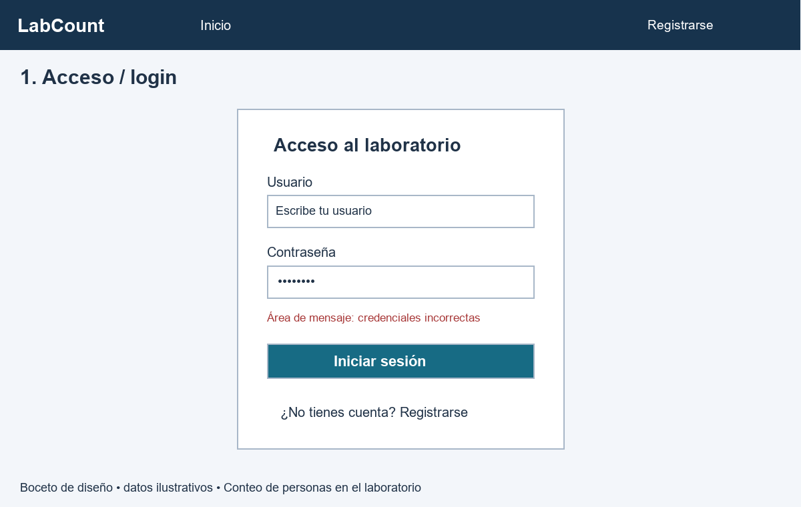
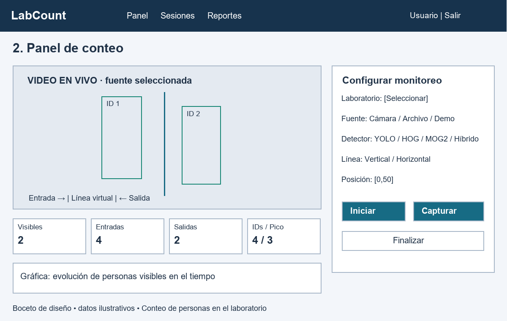
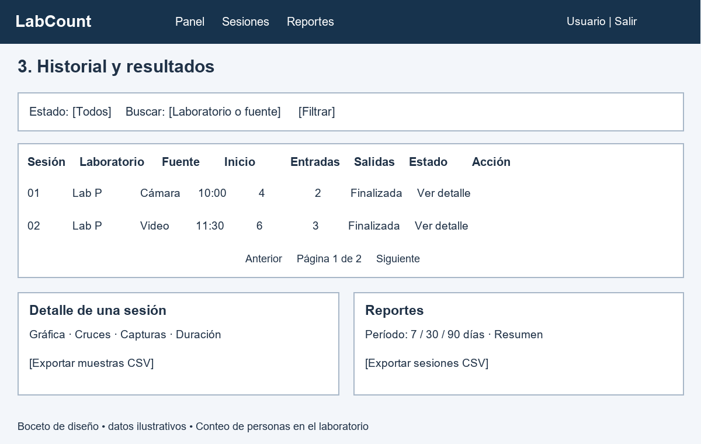

# Tres bocetos — Conteo de personas en el laboratorio

Bocetos de diseño, no capturas de ejecución. Representan las pantallas del tema elegido. Se incluyen como SVG editables y PNG para insertar en el informe. Las cifras ilustrativas no son resultados de prueba.

## 1. Acceso / login

[SVG editable](bocetos/01-acceso.svg). Responsable: Billy Dilson. Usuario, contraseña, mensaje de error, botón de acceso y enlace al registro. Corresponde a `templates/accounts/login.html`.

## 2. Panel de conteo

[SVG editable](bocetos/02-panel.svg). Responsable: Deyvi Matheus. Fuente cámara/archivo/demo, método de detección, laboratorio, orientación/posición de línea; video con cajas y línea, métricas, gráfica y controles iniciar/capturar/finalizar. Corresponde a `templates/monitoring/dashboard.html`.

## 3. Historial y resultados

[SVG editable](bocetos/03-historial.svg). Responsable: Jorge Alfredo. Filtros de estado y búsqueda, sesiones, fecha/fuente, entradas/salidas, paginación, acceso al detalle con gráfica/capturas y exportación. Corresponde a `templates/monitoring/sessions.html` y `session_detail.html`.

Ruth Noemi consolida las imágenes y descripciones en el PDF. La rúbrica usa ejemplos de biblioteca: consultar al docente la equivalencia con estas pantallas del tema permitido. Estos bocetos no crean un archivo en Figma; si el equipo lo utiliza, debe incorporar allí el diseño y su enlace real.
